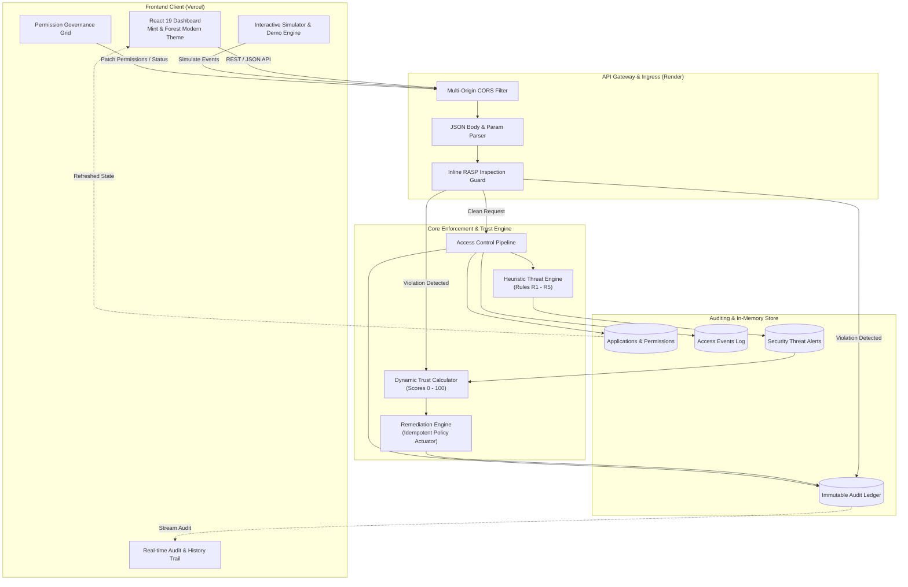

# E.D.I.T.H. — Enhanced Digital Identity, Trust & Heuristics
### *Next-Generation Zero-Trust Application Governance & Runtime Application Self-Protection (RASP)*

[](https://edith-virid-one.vercel.app/)
[](https://edith-backend-2qo8.onrender.com/api/health)
[](#testing--verification)
[](https://nodejs.org/)
[](https://vitejs.dev/)
[](LICENSE)

---

## 🌐 Live Deployments

| Component | Platform | Live URL | Status |
| :--- | :--- | :--- | :--- |
| **Frontend Application** | **Vercel** | [https://edith-virid-one.vercel.app/](https://edith-virid-one.vercel.app/) |  |
| **Backend REST API** | **Render** | [https://edith-backend-2qo8.onrender.com](https://edith-backend-2qo8.onrender.com) |  |
| **API Health Check** | **Render** | [https://edith-backend-2qo8.onrender.com/api/health](https://edith-backend-2qo8.onrender.com/api/health) |  |

---

## 📌 Executive Summary

Modern cloud and enterprise workspaces rely on third-party integrations, OAuth integrations, background daemons, and microservices. However, traditional security models treat authorization as a **one-time gate** (granted at install time) and rely on periodic, out-of-band log audits. 

**E.D.I.T.H.** redefines application access governance by unifying **Cloud Infrastructure Entitlement Management (CIEM)** with **Runtime Application Self-Protection (RASP)** and **Dynamic Continuous Trust Scoring**. 

Instead of trusting applications based on static privileges, EDITH continuously observes simulated access behaviors, detects runtime threats and protocol injection attacks in real time, computes mathematical trust penalties, and automatically applies least-privilege corrective countermeasures through an idempotent policy engine.

---

## 🛡️ Our Core USP: Deep Runtime Application Self-Protection (RASP)

Traditional Web Application Firewalls (WAFs) and Cloud Entitlement tools (CIEMs) operate outside application context:
1. **WAFs** sit at the perimeter without semantic understanding of application trust, context, or internal identity.
2. **CIEMs** run scheduled background syncs (often hours apart) and cannot stop in-flight runtime code execution or parameter exploitation.

**EDITH embeds an enterprise-grade RASP engine directly into the application request pipeline.** Every payload passing through the platform is inspected inline before controller execution.

```
                      ┌────────────────────────────────────────┐
                      │    HTTP Request Ingress                │
                      │    (Body, Query, Params, Path)         │
                      └───────────────────┬────────────────────┘
                                          │
                                          ▼
                      ┌────────────────────────────────────────┐
                      │     E.D.I.T.H. RASP ENGINE             │
                      │  • Unicode NFKC Normalization          │
                      │  • Recursive Percent-Decode            │
                      │  • Inline Comment Stripping            │
                      │  • Head & Tail Buffer Scan             │
                      └───────────────────┬────────────────────┘
                                          │
                         [Attack Signature Detected?]
                                   /             \
                             YES  /               \  NO (Clean)
                                 ▼                 ▼
          ┌───────────────────────────────┐   ┌───────────────────────────┐
          │      IMMEDIATE MITIGATION     │   │     ACCESS PIPELINE       │
          │  1. Block with 403 Forbidden  │   │  1. Check Permissions    │
          │  2. Prevent Controller Exec   │   │  2. Anomaly Engine (R1-5) │
          │  3. Log ACCESS_DENIED & ALERT │   │  3. Update Metrics        │
          │  4. Deduct Trust Penalty      │   │  4. 200 OK Response       │
          │  5. Trigger Quarantine Action │   └───────────────────────────┘
          └───────────────────────────────┘
```

### Comprehensive Attack Vector Defense
The EDITH RASP engine inspects and mitigates:

* **SQL Injection (SQLi)**: Blocks `UNION SELECT`, quoted tautologies (`' OR '1'='1`), numeric tautologies (`1=1`), stacked destructive commands (`; DROP TABLE`, `; TRUNCATE`), and comment obfuscation.
* **Path Traversal & Arbitrary File Access**: Intercepts `../`, multi-encoded `%2e%2e`, Unicode-escaped directory breaks, null bytes (`%00`), and sensitive OS target paths (`/etc/passwd`, `C:\Windows\System32`, `boot.ini`).
* **Command & Remote Code Execution (RCE)**: Stops shell pipelines (`;`, `|`, `&`), subshell expansions (`$(whoami)`, `` `id` ``), dynamic execution calls (`eval()`, `child_process`, `Function()`), JNDI/LDAP lookups (`${jndi:ldap...}`), and `<script>` cross-site scripting tags.
* **Parameter Tampering & Mass Assignment**: Rejects prototype pollution (`__proto__`, `constructor`), NoSQL operator injections (`$where`, `$regex`, `$ne`), HTTP Parameter Pollution (HPP), and attempts to elevate client privileges (e.g. tampering with `trustScore`, `isAdmin`, or `isSuperuser`).

### Anti-Evasion & Hardened Inspection
* **Recursive Multi-Layer Decode**: Defeats nested URL percent-encoding exploits.
* **Unicode NFKC Canonicalization**: Neutralizes full-width and lookalike character spoofing.
* **Dual-Window Buffer Scanning**: Inspects the first 16KB (head) and last 4KB (tail) of oversized payloads to prevent padding evasion.
* **Anti-Spoofing Cooldown Protection**: Prevents malicious actors from spoofing application IDs to artificially deplete another app's trust score.

---

## 🏛️ System Architecture

EDITH is architected as an end-to-end zero-trust ecosystem featuring a decoupled Vite/React client, an Express.js reactive backend, and a unified shared contract schema.



---

## 🚀 Key Features & Detailed Breakdown

### 1. Centralized Permission Governance & Least-Privilege Grid
Enforces strict role- and resource-based authorization across all installed enterprise applications.

```
┌─────────────────────────────────────────────────────────────────────────────┐
│ APPLICATION         LOCATION    CONTACTS     CAMERA    MICROPHONE    FILES   │
├─────────────────────────────────────────────────────────────────────────────┤
│ Fitness Tracker        [ON]       [OFF]       [OFF]       [OFF]      [ON]   │
│ Social Hub             [ON]       [ON]        [ON]        [ON]       [ON]   │
│ Cloud Sync Utility     [OFF]      [OFF]       [OFF]       [OFF]      [ON]   │
└─────────────────────────────────────────────────────────────────────────────┘
```

* **Per-Resource Granularity**: Independent switches for high-risk device capabilities (`location`, `contacts`, `camera`, `microphone`, `files`).
* **Zero-Trust Precedence**: Suspended applications cannot access resources even if individual permission flags are enabled.
* **Instant Propagation & Audit**: Any grant or revoke instantly records an immutable `permission_granted` or `permission_revoked` event with timestamp and actor attribution.

> **Screenshot Reference:**
> ``
> *(Location: Navigation -> Permissions. Interactive toggles with real-time feedback and audit verification).*

---

### 2. Live Access Activity Monitoring Stream
A high-throughput telemetry stream recording every simulated runtime interaction.

* **Deterministic Simulation Engine**: Dispatch bursts of 1 to 100 requests with custom timestamps, simulated delays, and context reasons.
* **Instant Visual Indicators**: Clear status badges indicating whether requests were `allowed` or `denied`.
* **Multi-Dimensional Filters**: Filter activity on the fly by Application, Target Resource, Access Status, or Suspicious flags.

> **Screenshot Reference:**
> ``
> *(Location: Navigation -> Monitoring. Filterable real-time event logs with status badges and request timestamps).*

---

### 3. Dynamic Trust Scoring & Explainability Engine
Rather than presenting arbitrary threat levels, EDITH calculates a transparent mathematical score ranging from **0 to 100**.

$$\text{Trust Score} = \max\left(0, 100 - \sum \text{Penalties}\right)$$

| Severity Tier | Point Deduction | Triggers & Examples |
| :--- | :---: | :--- |
| **Low** | **-3 pts** | Isolated access spike, first-time minor heuristic anomaly |
| **Medium** | **-8 pts** | Unauthorized access attempt on disabled resource, parameter anomaly |
| **High** | **-15 pts** | Access attempts while app is suspended, high-frequency location queries |
| **Critical** | **-25 pts** | RASP code injection / path traversal attack, simultaneous sensitive harvest |

#### Trust Levels
* 🟢 **High Trust (80 – 100)**: Normal operational standing; unrestricted governed access.
* 🟡 **Moderate Trust (60 – 79)**: Minor anomalies detected; flagged for supervisory review.
* 🟠 **Low Trust (40 – 59)**: Repeated violations; restricted access policies recommended.
* 🔴 **Critical Trust (0 – 39)**: Active threat / severe attack detected; automatic application suspension recommended.

> **Screenshot Reference:**
> ``
> *(Location: Navigation -> Trust Analysis. Interactive score breakdown, mathematical penalty ledger, and historical trend chart).*

---

### 4. Threat Intelligence & Anomaly Detection Rules
The built-in behavioral engine inspects access patterns across five heuristic detection rules:

* **Rule R1 (Excessive Access)**: Detects rapid-fire calls (>10 requests within a 60-second window to sensitive resources like GPS).
* **Rule R2 (Unauthorized Resource Access)**: Flags explicit requests to resources that have been disabled in the governance matrix.
* **Rule R3 (Suspended App Activity)**: Blocks and alerts whenever a quarantined/suspended app attempts runtime execution.
* **Rule R4 (Repeated Restricted Access)**: Flags repeated unauthorized access attempts (threshold: 3 failures within 5 minutes).
* **Rule R5 (Unusual Resource Combination)**: Detects suspicious multi-resource data harvesting (e.g. concurrent access to Camera + Microphone + Contacts within 30 seconds).

> **Screenshot Reference:**
> ``
> *(Location: Navigation -> Security. Threat cards with severity chips, trigger rules, and acknowledgment workflows).*

---

### 5. Automated, Idempotent Recommendation Engine
Bridges the gap between threat detection and administrative action by suggesting tailored security remediations.

```
                  ┌─────────────────────────────────────────┐
                  │       Heuristic Detection Event         │
                  └────────────────────┬────────────────────┘
                                       │
                                       ▼
                  ┌─────────────────────────────────────────┐
                  │       Recommendation Generation         │
                  │   • restrict_permission                 │
                  │   • suspend_app                         │
                  │   • keep_disabled                       │
                  └────────────────────┬────────────────────┘
                                       │
                         [Admin Clicks "Apply"]
                                       │
                                       ▼
                  ┌─────────────────────────────────────────┐
                  │       Idempotent Execution              │
                  │   • Executes Least-Privilege Action     │
                  │   • Transitions Status: pending->applied│
                  │   • Logs recommendation_applied         │
                  │   • Safe against duplicate clicks       │
                  └─────────────────────────────────────────┘
```

* **One-Click Remediation**: Resolve complex incidents instantly by revoking compromised permissions or quarantining entire apps.
* **Idempotency Guarantee**: Applying a recommendation multiple times safely returns the verified state without duplicate side-effects.

> **Screenshot Reference:**
> ``
> *(Location: Navigation -> Recommendations. Action cards with recommended steps, reasoning, and one-click Apply button).*

---

### 6. Interactive 7-Step E2E Demo Scenario
Built for hackathon judges, security researchers, and evaluators to witness the entire closed-loop architecture in seconds.

```
Step 1: Baseline Health Check     ──▶  Score: 94 (High Trust)
Step 2: 25 Excessive GPS Calls    ──▶  Alert: Excessive Access   ──▶  Score: 79 (Moderate)
Step 3: Unauthorized Contacts     ──▶  Alert: Disabled Resource  ──▶  Score: 71 (Moderate)
Step 4: Repeated Blocked Access   ──▶  Alert: Repeated Violation ──▶  Score: 63 (Moderate)
Step 5: Automated Recommendation  ──▶  Action: Restrict Location
Step 6: Policy Application        ──▶  Status: Revoked & Applied
Step 7: Full Audit Verification   ──▶  Ledger: 100% Traceable
```

* **One-Click Reset**: Dedicated `POST /api/demo/reset` endpoint restores the seed state to pristine initial conditions at any time.

---

### 7. Immutable Audit History & Compliance Trail
Maintains an append-only ledger of all platform occurrences, formatted to meet enterprise compliance standards (SOC 2, ISO 27001, HIPAA).

* Records 10 distinct activity event types:
  - `access_allowed`, `access_denied`, `alert_created`
  - `permission_granted`, `permission_revoked`
  - `app_suspended`, `app_reactivated`
  - `trust_score_changed`
  - `recommendation_created`, `recommendation_applied`
* Every entry contains a deterministic UUID, ISO-8601 UTC timestamp, application reference, and contextual metadata.

> **Screenshot Reference:**
> ``
> *(Location: Navigation -> History. Chronological audit stream with reverse-sorting, type filtering, and event JSON inspection).*

---

## 🎨 Design System & Visual Identity

The user interface of EDITH was meticulously designed with inspiration from modern engineering portfolios:
* **Color Palette**: High-contrast, clean layout infused with soft mint gradients (`#E8F5E9`, `#C8E6C9`), deep forest accents (`#1B4332`, `#2D6A4F`), and crisp neutral card backgrounds.
* **Responsive Grid**: Built with CSS Grid and Flexbox for seamless visualization on ultrawide monitors, laptops, tablets, and smartphones.
* **Typography**: Professional sans-serif system font stack optimized for rapid legibility of security telemetry.
* **Live Micro-Interactions**: Real-time toast notifications, subtle transitions, and accessible keyboard navigation.

---

## 🔌 API Reference & Authoritative Contracts

Base URL (Local): `http://localhost:4000`  
Base URL (Production): `https://edith-backend-2qo8.onrender.com`

All endpoints return a uniform JSON envelope:
* **Success**: `{ "success": true, "data": { ... }, "message": "..." }`
* **Error**: `{ "success": false, "error": { "code": "ERROR_CODE", "message": "..." } }`

| # | HTTP Method | Endpoint Path | Description |
| :-: | :--- | :--- | :--- |
| **1** | `GET` | `/api/health` | Service health status, uptime, and simulator indicator. |
| **2** | `GET` | `/api/apps` | List all applications with trust scores and permission sets. |
| **3** | `GET` | `/api/apps/:id` | Fetch detailed state of a single application by ID. |
| **4** | `PATCH` | `/api/apps/:id/permissions` | Grant or revoke a permission (`{ resource, enabled }`). |
| **5** | `PATCH` | `/api/apps/:id/status` | Suspend or reactivate an application (`{ status }`). |
| **6** | `GET` | `/api/events` | Query simulated access logs (supports `appId`, `status`, `limit`). |
| **7** | `POST` | `/api/events/simulate` | Execute simulated access burst and trigger threat detection. |
| **8** | `GET` | `/api/security/alerts` | Query security alerts with severity and acknowledgment filters. |
| **9** | `PATCH` | `/api/security/alerts/:id/acknowledge` | Acknowledge a security alert. |
| **10** | `GET` | `/api/security/score/:appId` | Retrieve mathematical trust score, level, and penalty breakdown. |
| **11** | `GET` | `/api/security/recommendations/:appId` | Query automated remediation recommendations for an application. |
| **12** | `POST` | `/api/security/recommendations/:id/apply` | Idempotently apply a recommendation's suggested action. |
| **13** | `GET` | `/api/history` | Retrieve the chronological audit history ledger. |
| **14** | `GET` | `/api/stats` | Global metrics (total apps, requests, alerts, avg trust). |
| **15** | `POST` | `/api/demo/reset` | Restore pristine seed dataset for clean evaluation. |

---

## 💻 Local Development & Quick Start

### Prerequisites
* **Node.js**: v18.0.0 or higher (v20+ recommended)
* **npm**: v9.0.0 or higher
* **Git**

### Installation Steps

1. **Clone the Repository**
   ```bash
   git clone https://github.com/sam9334545/EDITH.git
   cd EDITH
   ```

2. **Backend Setup**
   ```bash
   cd backend
   npm install
   cp .env.example .env
   npm start
   ```
   *The backend starts at `http://localhost:4000` (Verify via `http://localhost:4000/api/health`).*

3. **Frontend Setup**
   ```bash
   cd ../frontend
   npm install
   cp .env.example .env
   npm run dev
   ```
   *The frontend starts at `http://localhost:5173` with instant Vite HMR.*

---

## 🧪 Testing & Verification

The repository includes a comprehensive automated test harness covering unit tests, API integration tests, RASP middleware attack simulation, and end-to-end demo flows.

```bash
cd backend
npm test
```

### Test Suite Summary
```text
✔ E2E Demo Scenario & Activity History Audit Trail
✔ Feature 7: Activity History (M3)
✔ Controller & API Integration: GET /api/history and Triggers
✔ Feature 6: Access Control Backend Module (Approval, Revocation, Suspension, Reactivation)
✔ Heuristic Anomaly Detection Engine (Rules R1, R2, R3, R4, R5)
✔ RASP Direct Payload Inspection & Attack Vector Defense
✔ RASP Express Middleware (SQLi, Traversal, RCE, Tampering, Parameter Pollution)
✔ M4 & M2 - Recommendations Feature & Idempotency
✔ Security Alerts API & Acknowledgment Workflows
✔ Trust Scoring Calculation, Boundary Verification & Explainability

ℹ tests 176
ℹ suites 34
ℹ pass 176
ℹ fail 0
```

---

## 🔒 Security Posture & Environment Variables

### Backend Configuration (`backend/.env`)
```ini
PORT=4000
NODE_ENV=production
FRONTEND_URL=https://edith-virid-one.vercel.app

# RASP Engine Configuration
RASP_ENABLED=true        # Master kill-switch (true | false)
RASP_MODE=block          # Enforcement mode: 'block' (active defense) or 'monitor' (telemetry only)
```

### Frontend Configuration (`frontend/.env`)
```ini
# Points to Render backend in production, or empty string for local Vite proxy
VITE_API_URL=https://edith-backend-2qo8.onrender.com
```

---

## 👥 Engineering Team & Credits

Developed with precision for the Hackathon by:
* **M1**: Backend Core, Ingress Gateway & Aggregations
* **M2**: Centralized Permissions & Application Lifecycle
* **M3**: Access Telemetry, Simulation & Activity History
* **M4**: Threat Intelligence, Trust Scoring & Recommendation Engine
* **M5**: Modern Web UI, Visualization & Responsive Architecture
* **Security & RASP**: Embedded Runtime Protection & Attack Mitigation

---

## 📄 License
This project is open-source under the [MIT License](LICENSE).
